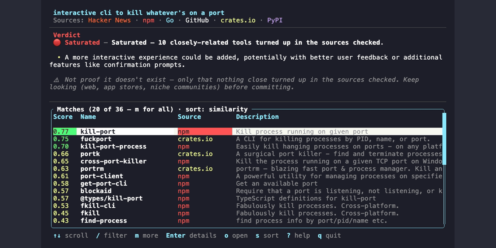
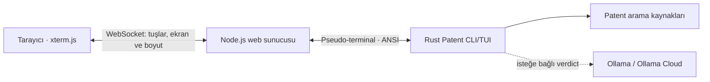

<p align="center">
  
</p>

<h1 align="center">Patent Web</h1>

<p align="center">
  <strong>Patent’in geliştirici araçları için öncül-art arama deneyimini, tarayıcıdan kullanılabilir bir arayüzle sunan topluluk projesi.</strong>
</p>

<p align="center">
  <a href="https://github.com/r14dd/patent"></a>
  
  
  
  
</p>

<p align="center">
  <a href="#turkce">Türkçe</a> ·
  <a href="#english">English</a> ·
  <a href="#espanol">Español</a> ·
  <a href="#francais">Français</a> ·
  <a href="#deutsch">Deutsch</a> ·
  <a href="#portugues">Português</a> ·
  <a href="#日本語">日本語</a> ·
  <a href="#简体中文">简体中文</a> ·
  <a href="#العربية">العربية</a>
</p>

<p align="center">
  
</p>

<p align="center">
  <em>Yukarıdaki görsel ve aşağıdaki GIF, upstream Patent deposundaki proje varlıklarıdır. GIF, özgün terminal arayüzünü gösterir; bu web uygulamasının tarayıcı ekran görüntüsü değildir.</em>
</p>

<p align="center">
  
</p>

<p align="center"><em>Özgün Patent CLI demosu · Kaynak: <a href="https://github.com/r14dd/patent">r14dd/patent</a></em></p>

---

<a id="turkce"></a>
## Türkçe

### Patent Web nedir?

Patent Web, [r14dd/patent](https://github.com/r14dd/patent) projesinin terminal uygulamasını tarayıcıdan kullanılabilir hâle getiren **resmî olmayan bir web uyarlamasıdır**. Arama motorunu ve terminal arayüzünü baştan yazmak yerine Rust tabanlı Patent uygulamasını bir pseudo-terminal içinde çalıştırır; terminal çıktısını tarayıcıda xterm.js ile görüntüler ve klavye girdilerini uygulamaya iletir.

Bu proje, Patent’in yazarı veya bakımcıları tarafından yayımlanmamıştır; upstream proje ile resmî bir bağlantısı ya da onayı yoktur. Patent’in ne yaptığına dair ayrıntılar için arşivlenen upstream [README](docs/upstream-patent/README.md) dosyasına bakın.

### Öne çıkanlar

- Patent’in arama ve sonuç akışını tarayıcıdan kullanma
- CLI ile aynı Rust uygulaması ve TUI; ayrı bir web arama motoru değildir
- xterm.js, WebSocket ve `node-pty` üzerinden etkileşimli terminal
- Pencere yeniden boyutlandırma, fareyle metin seçimi ve klavye kısayolları
- GitHub ve Hacker News dâhil 19 upstream arama kaynağı
- Yerel Ollama veya isteğe bağlı Ollama Cloud `beam:cloud` verdict desteği
- Varsayılan olarak yalnızca `127.0.0.1` adresinde çalışan yerel web sunucusu

### Nasıl çalışır?



Tarayıcı terminali `FitAddon` ile kullanılabilir alana göre ölçülür. Ölçülen satır ve sütun sayısı WebSocket üzerinden `node-pty` sürecine iletilir. Patent’in TUI’si çizimi ve klavye davranışını yönetir; tarayıcı bu çıktıyı gösterir.

### Gereksinimler

| Gereksinim | Açıklama |
|---|---|
| Node.js 20 veya üzeri | Web sunucusu, testler ve ön yüz derlemesi |
| npm | Bağımlılıkların kurulması |
| Rust 1.88 veya üzeri ve Cargo | Sunucu başlarken Patent CLI’yi kaynak koddan derler |
| C/C++ derleme araçları | Yalnızca `node-pty` için hazır yerel paket kullanılamazsa gerekir |
| İnternet bağlantısı | Patent’in kaynakları araması ve ilk yerel embedding modelinin indirilmesi için |

Linux’ta yerel `node-pty` derlemesi gerekirse temel araçları şu şekilde kurabilirsiniz:

```bash
sudo apt install build-essential python3 make
```

Patent ilk semantik aramada yaklaşık 80 MB’lık embedding modelini indirebilir. Model yerel önbelleğe alındıktan sonra yeniden indirilmez. Patent kaynaklarının araması internet bağlantısı gerektirir.

### Kurulum ve çalıştırma

```bash
git clone <bu-deponun-adresi>
cd Patent-Web
npm ci
npm start
```

Ardından [http://127.0.0.1:4173](http://127.0.0.1:4173) adresini açın. `npm start`, Rust CLI’yi Cargo ile derler ve yerel web sunucusunu başlatır. İlk derleme Cargo bağımlılıklarını indirebilir ve biraz zaman alabilir.

Rust veya Cargo kurulu değilse önce [rustup](https://rustup.rs/) ile Rust stable kurun. `spawn cargo ENOENT` hatası, `cargo` komutunun PATH içinde bulunmadığını gösterir.

### İsteğe bağlı LLM verdict

Patent araması için harici LLM zorunlu değildir; `--fast` modu verdict’i benzerlik verilerinden üretir. Yerel LLM kullanımı için [Ollama](https://ollama.com/) kurup model indirin:

```bash
ollama pull qwen3.5
npm start
```

Ollama Cloud `beam:cloud` kullanmak için:

```bash
./start-beam.sh
```

Bu betik API anahtarını gizli girişle alır ve yalnızca çalışan sunucu sürecinin ortam değişkenine aktarır; anahtarı README’ye, kaynak dosyalara veya Git’e eklemeyin. Cloud verdict kullanıldığında arama fikri verdict üretimi için Ollama Cloud’a gönderilir. API anahtarı istemci tarafındaki JavaScript’e aktarılmaz.

### Komutlar ve doğrulama

```bash
npm start          # Yerel web sunucusunu ve Patent TUI'yi başlat
npm test            # Web yapılandırma ve kısayol testleri
npm run test:web    # HTTP, WebSocket, TUI girdisi ve pencere boyutu smoke testleri
```

`npm run test:web`, sunucu çalışmıyorsa kendisi başlatmayı dener. HTTP uçlarını; CLI ile WebSocket TUI çıktısının eşleşmesini; terminal boyutlandırmasını; metin girişi, Ctrl+Backspace ve arama alanında Ctrl+A ile imleci başa taşıma davranışını kontrol eder.

### Klavye ve fare

| Tuş | Davranış |
|---|---|
| `Ctrl+A` | Arama alanında imleci başa taşır |
| `Ctrl+Backspace` | İmlecin solundaki sözcüğü siler |
| `Ctrl+C` | Seçili metni kopyalar; seçim yoksa terminali kesmez |
| `Ctrl+V` | Panodaki metni arama alanına yapıştırır |
| `↑` / `↓` | Sonuçlarda gezinir |
| `/` | Sonuçları filtreler |
| `Enter` | Seçili sonucun ayrıntılarını açar |
| `o` | Sonuç bağlantısını tarayıcıda açar |
| `y` | Seçili bağlantıyı panoya kopyalar |
| `s` | Sıralamayı değiştirir |
| `n` | Yeni arama başlatır |
| `?` | Yardım ekranını açar |
| `q` | Uygulamadan çıkar |

Web sürümünde fareyle terminal metni seçilebilir. `Ctrl+A` tarayıcının tamamını seçmez; Patent arama alanındaki imleci başa taşır.

### Arama kaynakları

Upstream Patent sürümünde şu 19 kaynak bulunur: crates.io, GitHub, npm, PyPI, Hacker News, Go, Maven, RubyGems, Docker Hub, VS Code Marketplace, JetBrains, NuGet, Homebrew, Packagist, Hex, Artifact Hub, AUR, Hackage ve Nixpkgs. Hangi kaynakların çalıştığı ve sonuç verdiği arama fikrine, bağlantıya ve upstream davranışına bağlıdır.

### Sınırlamalar

Patent bir patent veri tabanı veya hukuki görüş hizmeti değildir. Sonuçlar yalnızca sorgulanan kaynaklarda bulunan eşleşmeleri özetler; “Open” sonucu fikrin daha önce hiç uygulanmadığını kanıtlamaz. Bu araç patentlenebilirlik, yenilik veya hukuki uygunluk garantisi vermez.

Sunucu varsayılan olarak `127.0.0.1:4173` üzerinde dinler. Güvenlik ve erişim denetimi eklemeden bunu herkese açık bir ağa açmayın.

### Kaynak, atıf ve lisans

Bu depo, [Riad Mukhtarov’un `r14dd/patent` projesinden](https://github.com/r14dd/patent) Rust kaynak kodu ve arayüz davranışını alıp web kullanımına uyarlamaktadır. Upstream README ve ek dosyalar `docs/upstream-patent/`, görseller `assets/upstream-patent/` altında korunur. Upstream kaynak, kendi bildiriminde **MIT veya Apache-2.0** lisanslarından biriyle sunulmuştur; koşullar için [upstream MIT lisansını](LICENSE) ve [upstream Apache-2.0 lisansını](LICENSE) okuyun.

Bu depo, yeni katkılar da dâhil olmak üzere **MIT veya Apache-2.0** lisanslarından biriyle sunulur. Upstream kaynak dosyalarındaki telif bildirimleri `NOTICE.md` ve arşivlenmiş upstream dosyalarında korunur. Lisans metinleri için [`LICENSE`](LICENSE) ve [`LICENSE`](LICENSE) dosyalarını okuyun. Patent Web resmî bir upstream ürünü değildir. Bu açıklama hukuki danışmanlık değildir.

---

<a id="english"></a>
## English

### What is Patent Web?

Patent Web is an **unofficial browser adaptation** of the terminal application from [r14dd/patent](https://github.com/r14dd/patent). It runs the Rust Patent CLI inside a pseudo-terminal, streams its terminal output to xterm.js in the browser, and forwards keyboard input and resize events over WebSocket. It reuses the upstream search engine and TUI instead of implementing a separate search product.

This repository is not published, maintained, affiliated with, or endorsed by the original author. See the archived [upstream README](docs/upstream-patent/README.md) for Patent’s search behavior and limitations.

### Features

- Use Patent’s interactive search and results view in a browser
- The same Rust CLI/TUI powers both terminal and web sessions
- xterm.js, WebSocket, and `node-pty` provide the interactive terminal
- Responsive terminal sizing, browser text selection, and keyboard shortcuts
- The upstream project searches 19 sources, including GitHub and Hacker News
- Local Ollama verdicts or optional Ollama Cloud `beam:cloud`
- The web server binds to `127.0.0.1` by default

### Requirements

- Node.js 20+ and npm
- Rust 1.88+ with Cargo
- Internet access for upstream searches and the first embedding-model download
- A C/C++ build toolchain only if npm has to compile `node-pty` locally

On Debian or Ubuntu, install native build tools if needed:

```bash
sudo apt install build-essential python3 make
```

The first semantic search may download an approximately 80 MB embedding model for local use.

### Quick start

```bash
git clone <repository-url>
cd Patent-Web
npm ci
npm start
```

Replace `<repository-url>` with the clone URL after creating your GitHub repository.

Open [http://127.0.0.1:4173](http://127.0.0.1:4173). On startup, Cargo builds the Rust CLI and the Node.js process serves the web client. Install Rust with [rustup](https://rustup.rs/) if `cargo` is missing (`spawn cargo ENOENT`).

### Optional LLM setup

For a local verdict model, install [Ollama](https://ollama.com/) and run `ollama pull qwen3.5`. To use Ollama Cloud Beam, run `./start-beam.sh` and enter the key at its hidden prompt. Keep API keys out of source files and Git. With a cloud verdict enabled, the idea is sent to Ollama Cloud to produce that verdict. `--fast` skips the LLM verdict.

### Commands and checks

```bash
npm start
npm test
npm run test:web
```

The web smoke test checks HTTP assets, WebSocket/CLI output parity, terminal resizing, text input, Ctrl+Backspace, Ctrl+A cursor movement, and clean exit.

Contribution guidelines are in [`CONTRIBUTING.md`](CONTRIBUTING.md); security reporting and safe local deployment notes are in [`SECURITY.md`](SECURITY.md).

### Attribution and licensing

This repository adapts Rust source code and interface behavior from [Riad Mukhtarov’s `r14dd/patent`](https://github.com/r14dd/patent). The upstream README and auxiliary files are retained under `docs/upstream-patent/`; the original demo assets are under `assets/upstream-patent/`. Upstream files are offered under **MIT OR Apache-2.0**; read [`LICENSE`](LICENSE) and [`LICENSE`](LICENSE) and comply with the selected license’s terms.

This repository, including its new contributions, is offered under **MIT OR Apache-2.0**. Upstream copyright notices are preserved in `NOTICE.md` and the archived upstream files. Read [`LICENSE`](LICENSE) and [`LICENSE`](LICENSE) for the license texts. Patent Web is not an official upstream product. This notice is not legal advice.

Patent reports matches found in searched sources; it cannot prove that an idea has never been built or provide a patentability opinion. Do not expose the local server to a public network without adding appropriate access controls.

---

<a id="espanol"></a>
## Español

Patent Web es una **adaptación web no oficial** de la aplicación de terminal [r14dd/patent](https://github.com/r14dd/patent). Ejecuta el programa Rust original en un pseudo-terminal y transmite la interfaz al navegador mediante xterm.js y WebSocket.

### Requisitos y ejecución

Necesitas Node.js 20+, npm, Rust 1.88+ con Cargo y conexión a Internet. Si `node-pty` debe compilarse localmente en Debian/Ubuntu, instala `build-essential`, `python3` y `make`.

```bash
npm ci
npm start
```

Abre [http://127.0.0.1:4173](http://127.0.0.1:4173). La primera búsqueda semántica puede descargar un modelo local de aproximadamente 80 MB. Para Beam Cloud opcional, ejecuta `./start-beam.sh`; la clave se solicita sin mostrarla y no debe guardarse en Git.

El proyecto reutiliza y adapta código de Riad Mukhtarov. Los avisos y licencias originales se conservan en la raíz (`LICENSE` y `LICENSE`). Este proyecto no es oficial ni está respaldado por el autor original. Patent muestra coincidencias de las fuentes consultadas, pero no demuestra que una idea sea inédita ni ofrece asesoramiento legal.

---

<a id="francais"></a>
## Français

Patent Web est une **adaptation web non officielle** de l’application terminal [r14dd/patent](https://github.com/r14dd/patent). Elle exécute le programme Rust d’origine dans un pseudo-terminal et transmet son interface au navigateur avec xterm.js et WebSocket.

### Prérequis et lancement

Il faut Node.js 20+, npm, Rust 1.88+ avec Cargo et une connexion Internet. Si `node-pty` doit être compilé sous Debian/Ubuntu, installez `build-essential`, `python3` et `make`.

```bash
npm ci
npm start
```

Ouvrez [http://127.0.0.1:4173](http://127.0.0.1:4173). La première recherche sémantique peut télécharger un modèle local d’environ 80 Mo. Pour Beam Cloud en option, lancez `./start-beam.sh`; la clé est demandée sans affichage et ne doit jamais être ajoutée à Git.

Ce projet réutilise et adapte du code de Riad Mukhtarov. Les avis et licences d’origine sont conservés à la racine (`LICENSE` et `LICENSE`). Ce projet n’est ni officiel ni approuvé par l’auteur d’origine. Les résultats portent uniquement sur les sources consultées et ne constituent pas un avis juridique.

---

<a id="deutsch"></a>
## Deutsch

Patent Web ist eine **inoffizielle Webanpassung** der Terminalanwendung [r14dd/patent](https://github.com/r14dd/patent). Sie startet das ursprüngliche Rust-Programm in einem Pseudo-Terminal und überträgt dessen Oberfläche mit xterm.js und WebSocket in den Browser.

### Voraussetzungen und Start

Benötigt werden Node.js 20+, npm, Rust 1.88+ mit Cargo und Internetzugang. Falls `node-pty` unter Debian/Ubuntu lokal gebaut werden muss, installiere `build-essential`, `python3` und `make`.

```bash
npm ci
npm start
```

Öffne [http://127.0.0.1:4173](http://127.0.0.1:4173). Die erste semantische Suche kann ein lokales Modell mit etwa 80 MB herunterladen. Für optionales Beam Cloud starte `./start-beam.sh`; der Schlüssel wird verdeckt abgefragt und gehört nicht in Git.

Dieses Projekt übernimmt und ändert Quellcode von Riad Mukhtarov. Die ursprünglichen Hinweise und Lizenzen bleiben im Stammverzeichnis (`LICENSE` und `LICENSE`) erhalten. Das Projekt ist inoffiziell und wird vom ursprünglichen Autor nicht unterstützt oder bestätigt. Die Ergebnisse beziehen sich nur auf geprüfte Quellen und sind keine Rechtsberatung.

---

<a id="portugues"></a>
## Português

Patent Web é uma **adaptação web não oficial** do aplicativo de terminal [r14dd/patent](https://github.com/r14dd/patent). Ela executa o programa Rust original em um pseudo-terminal e transmite sua interface ao navegador usando xterm.js e WebSocket.

### Requisitos e execução

Você precisa de Node.js 20+, npm, Rust 1.88+ com Cargo e acesso à Internet. Se `node-pty` precisar ser compilado localmente no Debian/Ubuntu, instale `build-essential`, `python3` e `make`.

```bash
npm ci
npm start
```

Abra [http://127.0.0.1:4173](http://127.0.0.1:4173). A primeira busca semântica pode baixar um modelo local de aproximadamente 80 MB. Para usar Beam Cloud opcionalmente, execute `./start-beam.sh`; a chave é solicitada sem exibição e não deve ser incluída no Git.

Este projeto reutiliza e adapta código de Riad Mukhtarov. Os avisos e licenças originais estão preservados na raiz; consulte `LICENSE` e `LICENSE`. O projeto não é oficial nem endossado pelo autor original. Os resultados cobrem apenas as fontes consultadas e não são aconselhamento jurídico.

---

<a id="日本語"></a>
## 日本語

Patent Web は、[r14dd/patent](https://github.com/r14dd/patent) のターミナルアプリをブラウザーから使えるようにした**非公式の Web 版**です。元の Rust アプリを疑似端末で実行し、xterm.js と WebSocket で画面と入力を転送します。

### 必要なものと起動方法

Node.js 20 以降、npm、Cargo を含む Rust 1.88 以降、インターネット接続が必要です。Debian/Ubuntu で `node-pty` のローカルビルドが必要な場合は `build-essential`、`python3`、`make` をインストールしてください。

```bash
npm ci
npm start
```

ブラウザーで [http://127.0.0.1:4173](http://127.0.0.1:4173) を開きます。初回のセマンティック検索では約 80 MB のローカルモデルをダウンロードする場合があります。任意の Beam Cloud を使う場合は `./start-beam.sh` を実行します。API キーは Git に保存しないでください。

このプロジェクトは Riad Mukhtarov のコードを再利用・改変しています。元のライセンスと著作権表示はルートにあります（`LICENSE`、`LICENSE`）。本プロジェクトは非公式で、原作者による承認やサポートを受けていません。検索結果は確認した情報源に限られ、法的助言ではありません。

---

<a id="简体中文"></a>
## 简体中文

Patent Web 是 [r14dd/patent](https://github.com/r14dd/patent) 终端应用的**非官方 Web 适配版**。它在伪终端中运行原有 Rust 程序，并通过 xterm.js 和 WebSocket 将终端画面及输入传到浏览器。

### 依赖与启动

需要 Node.js 20 或更高版本、npm、Rust 1.88 或更高版本（含 Cargo）以及互联网连接。如果 Debian/Ubuntu 上需要本地编译 `node-pty`，请安装 `build-essential`、`python3` 和 `make`。

```bash
npm ci
npm start
```

在浏览器打开 [http://127.0.0.1:4173](http://127.0.0.1:4173)。首次语义搜索可能下载约 80 MB 的本地模型。可选的 Beam Cloud 可通过 `./start-beam.sh` 启动；API 密钥不会显示在输入过程中，也不要将其提交到 Git。

本项目复用并修改了 Riad Mukhtarov 的代码。原始版权声明和许可文件保留在项目根目录（`LICENSE`、`LICENSE`）。本项目不是官方项目，也未获原作者认可。搜索结果仅涉及已查询的数据源，不构成法律意见。

---

<a id="العربية"></a>
## العربية

Patent Web هو **تكييف ويب غير رسمي** لتطبيق الطرفية [r14dd/patent](https://github.com/r14dd/patent). يشغّل برنامج Rust الأصلي داخل طرفية زائفة، وينقل واجهته ومدخلات لوحة المفاتيح إلى المتصفح باستخدام xterm.js وWebSocket.

### المتطلبات والتشغيل

تحتاج إلى Node.js 20 أو أحدث، وnpm، وRust 1.88 أو أحدث مع Cargo، واتصال بالإنترنت. إذا احتاج `node-pty` إلى بناء محلي على Debian أو Ubuntu، ثبّت `build-essential` و`python3` و`make`.

```bash
npm ci
npm start
```

افتح [http://127.0.0.1:4173](http://127.0.0.1:4173). قد يُنزّل أول بحث دلالي نموذجاً محلياً بحجم يقارب 80 ميغابايت. لاستخدام Beam Cloud اختيارياً، شغّل `./start-beam.sh`؛ لا تحفظ مفتاح API في Git.

يعيد هذا المشروع استخدام وتعديل شيفرة Riad Mukhtarov. إشعارات حقوق النشر والتراخيص الأصلية محفوظة في جذر المشروع (`LICENSE` و`LICENSE`). المشروع غير رسمي ولا يحظى بتأييد المؤلف الأصلي. النتائج تقتصر على المصادر التي جرى البحث فيها ولا تُعدّ استشارة قانونية.

---

## Project tree

```text
Patent-Web/
├── app.js                 # xterm.js client, clipboard and keyboard handling
├── server.mjs             # Node.js HTTP/WebSocket server and node-pty bridge
├── web-config.mjs         # terminal sizing, clipboard shortcuts and options
├── terminal.css           # full-viewport terminal layout
├── web-smoke.mjs          # HTTP, WebSocket, resize and CLI-parity smoke test
├── package.json           # JavaScript dependencies and commands
├── Cargo.toml              # Rust CLI crate, built by the web server
├── LICENSE             # project license
├── LICENSE          # project license
├── NOTICE.md                # upstream source attribution
├── CONTRIBUTING.md          # development and pull request guide
├── SECURITY.md              # security reporting and deployment notes
├── src/                    # Rust search engine and TUI
├── tests/                  # Rust test suites
├── .github/workflows/       # CI checks
├── assets/upstream-patent/ # original upstream preview and demo
└── docs/upstream-patent/   # archived upstream documentation and metadata
```

## Credits

- **Patent CLI and search engine:** [Riad Mukhtarov / r14dd/patent](https://github.com/r14dd/patent)
- **Terminal renderer:** [xterm.js](https://xtermjs.org/)
- **Pseudo-terminal bridge:** [node-pty](https://github.com/microsoft/node-pty)
- **Rust TUI:** [Ratatui](https://ratatui.rs/)

<p align="center"><sub>Unofficial community web adaptation. Preserve upstream attribution and license notices when redistributing.</sub></p>
